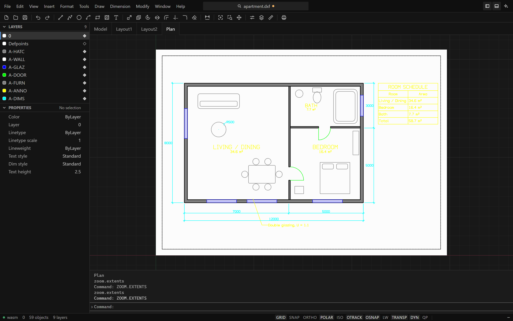
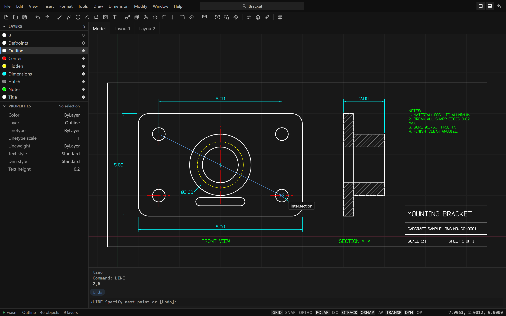
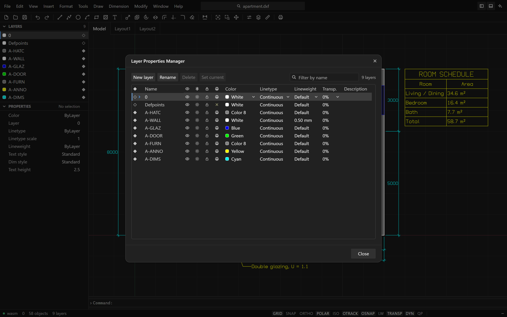

<p align="center">
  <a href="https://getartcraft.com/">
    <picture>
      <source media="(prefers-color-scheme: dark)" srcset="docs/brand/artcraft-logo-white.svg">
      
    </picture>
  </a>
</p>

<p align="center">
  
</p>

<h1 align="center">CADCraft</h1>

<p align="center">
  <b>Computer-aided design and drafting; an open-source, modern 2D and 3D CAD application, built in pure Rust.</b>
</p>

<p align="center">
  A fast, open-source CAD workflow: the command line, object snaps, layers,
  dimensions, hatches, blocks and DXF drawings you already know. It runs natively on macOS,
  Windows, Linux and FreeBSD, and in the browser via WebAssembly.<br>
  <i>By the ArtCraft team.</i>
</p>

<p align="center">
  
  
  
  
  
  <br>
  <a href="https://sonarcloud.io/project/overview?id=storytold_cadcraft"></a>
  <a href="https://coderabbit.ai"></a>
</p>

<p align="center">
  <a href="https://discord.gg/artcraft"></a>
</p>

<p align="center">
  <a href="https://getartcraft.com/apps/cadcraft"><b>CADCraft on getartcraft.com</b></a> ·
  <a href="https://getartcraft.com/">ArtCraft</a> ·
  <a href="https://getartcraft.com/apps">All Crafting Apps</a>
</p>

<br>

<p align="center">
  
  <br><sub><b>Apartment plan</b> (<a href="examples/apartment.dxf">examples/apartment.dxf</a>): walls with pick-point hatching, TrueType MTEXT room labels, a TABLE, a multileader and architectural dimensions — built entirely from CADCraft commands.</sub>
</p>

> [!NOTE]
> **ArtCraft is a community of artists from all walks of life.** Painters, photographers,
> filmmakers, illustrators, designers, animators, hobbyists, and people who picked up a pencil
> last week. If you make things, you're one of us. **[Come say hi on Discord](https://discord.gg/artcraft).**

<p align="center">
  <a href="#screenshots">Screenshots</a> ·
  <a href="#why-cadcraft">Why CADCraft</a> ·
  <a href="#what-works-today">What works today</a> ·
  <a href="#quick-start">Quick start</a> ·
  <a href="#drive-it-from-agents-mcp-and-the-cli">Agents, MCP and the CLI</a> ·
  <a href="#architecture">Architecture</a> ·
  <a href="#roadmap">Roadmap</a> ·
  <a href="#downloads">Downloads</a> ·
  <a href="#the-crafting-apps">The Crafting Apps</a> ·
  <a href="#license-and-credits">License and credits</a>
</p>

## Screenshots

These pictures show the interface as it is now, taken in a browser at 1440 by 900: an example
floor plan with a door selected, a paper-space layout of it, the sample part while a line is
being drawn, and the Layer Properties Manager.

<table>
  <tr>
    <td width="50%"></td>
    <td width="50%"></td>
  </tr>
  <tr>
    <td><sub><b>Layouts</b>: paper space with viewports, page setups and PLOT to PDF. Double-click a viewport to work in model space through it.</sub></td>
    <td><sub><b>Mounting bracket</b>: a two-view part drawing with centre lines, hidden lines, an ANSI31 section hatch and a title block.</sub></td>
  </tr>
</table>

<p align="center">
  
</p>

## Why CADCraft

- **The workflow you know.** Type `L`, click two points, type `@5<45`, press Enter. The command
  line, prompts with clickable `[Keywords]`, object snaps with a marker under the pointer,
  direct distance entry, window and crossing selection, and right-click to repeat behave the way
  decades of drafting habit expect.
- **Open files.** DXF is read and written natively (ASCII and binary, R12 through 2018). DWG
  files (R13 through 2018) are read and written through the open-source acadrust library by the
  command-line tool; the app itself opens and saves DXF for now. Export to SVG, PNG and PDF
  from the command-line tool.
- **One interface everywhere.** The engine is pure Rust; the interface is a small SolidJS app
  that runs it as WebAssembly. The desktop app is that interface in a native window (the
  system's own webview, no bundled browser), and the same build runs in a browser tab.
- **Built for agents.** Every menu item, tool and prompt is a command. Agents can type at the
  command line exactly like a person, call any command with JSON, inspect the drawing to verify
  their work, and render it, over MCP or the CLI.
- **Free.** MIT OR Apache-2.0, with no account and no subscription.

## What works today

CADCraft is in early, fast development. Honest status (see [ROADMAP.md](ROADMAP.md) for parity
numbers). The engine is ahead of the interface: the interface was rebuilt in November 2026, and a
command that used to open a dialog now runs as its command-line prompts. The first two rows say
what the app's window does today; the rest say what the commands do, from the app's command line,
the CLI and MCP alike.

| Area | Status |
|---|---|
| The app's window | Laid out as an editor: menus and a command centre in the title bar, a drawing toolbar (draw, modify, dimension, zoom), Layers and Properties in a sidebar, layout tabs over the drawing, the command line as the bottom panel, an assistant panel, a status bar of drafting toggles, and a command palette (`Ctrl+Shift+P`). Drawing with the pointer: a click gives a running command its point, with a rubber band and an object-snap marker, held to ortho, polar tracking, grid snap and object snap tracking when they are on; dynamic input at the pointer; grips on a selection (stretch, move, rotate, scale, mirror); right-click menus on the drawing, layer rows and layout tabs; a Layer Properties Manager and a Drafting Settings dialog; a layout drawn on its sheet of paper; a recovery copy of unsaved work kept in the browser and offered back after a crash; hover highlight, window and crossing selection, right click as Enter, middle-button pan, wheel zoom, touch pan and pinch. Dark and light themes. Keyboard access through the whole window. [Details](apps/ui/README.md) |
| Not in the app's window yet | Every dialog but Drafting Settings and the Layer Properties Manager (Options, Plot, Hatch, the block and text editors), layer states and filters, the snap menu, grips for touch, DWG, file tabs, languages other than English. [The list](docs/gaps.md#uiux) |
| Command line | Prompts with keywords, history, aliases, `@dx,dy`, `@d<a`, `#x,y`, direct distance entry, Enter/space/right-click to repeat, transparent commands, scripts through the CLI |
| Draw | LINE, PLINE (arcs, widths), CIRCLE (center/radius/diameter, 2P, 3P), ARC, RECTANG (fillet/chamfer), POLYGON, ELLIPSE (+arcs), SPLINE, POINT, XLINE, RAY, DONUT, TEXT, MTEXT |
| Modify | ERASE, MOVE, COPY, ROTATE, SCALE, MIRROR, STRETCH, OFFSET, TRIM, EXTEND, FILLET, CHAMFER, BREAK, JOIN, EXPLODE, rectangular/polar ARRAY, draw order, OVERKILL |
| Precision | Object snaps (endpoint, midpoint, center, geometric center, node, quadrant, intersection, insertion, perpendicular, tangent, nearest; deferred tangent/perpendicular for the first point of a line, e.g. belt lines tangent to two circles), typed point modifiers (FROM, M2P, point filters, snap overrides), and polar tracking, object snap tracking, ortho (Shift flips it) and grid snap under the pointer, with a label that names the constraint and its distance and angle |
| Layers & properties | Layers palette (current layer, on/off, freeze, lock), the LAYER command for the rest (plot, colour, linetype), layer tools (isolate, freeze, off, lock, match, previous), Properties palette editing the common properties, linetypes, lineweights, colour index and true colour |
| Annotation | All DIM* commands with full DIMSTYLE variables, overrides and every arrowhead, associative dimensions that follow geometry, MLEADER, TABLE, TrueType fonts (`.ttf`, `.otf`, `.ttc` collections), MTEXT formatting codes (fonts, heights, colours, stacked fractions), our own single-stroke drafting font |
| Hatch & blocks | Pick-point hatch boundaries with islands, pattern, solid and gradient fills from our own pattern library, BLOCK/INSERT, attributes and nested blocks |
| Files | DXF read (R12–2018, ASCII and binary) and write, including dimension styles, associativity, tables and constraints; DWG read and write through the acadrust library and PDF plotting, SVG and PNG export, all three from `cadcraft-cli` (the app's window opens and saves DXF). Not everything CADCraft doesn't model is kept on save: see [file-format parity](docs/file-format-parity.md) |
| Layouts & plotting | Paper-space layouts, viewports (scale, lock, per-viewport layer freeze), MSPACE/PSPACE through viewports, page setups, PLOT and EXPORTPDF |
| Parametric | Geometric and dimensional constraints, AUTOCONSTRAIN, PARAMETERS with expressions, conflict detection; constraints re-solve after every edit |
| Interface languages | English. The earlier interface's translations (15 languages) went with it and have not been redone |
| Automation | MCP server (one `run` tool: AutoLISP in the open drawing), `cadcraft-cli` (info, convert, run, commands, mcp), in-app assistant |

## Quick start

CADCraft requires Rust 1.95 or later.

```sh
git clone https://github.com/storytold/cadcraft
cd cadcraft
cd apps/ui && bun install && bun run build:wasm && bun run build && cd ../..
cargo run --release -p cadcraft                   # the desktop app, on the sample drawing
```

The first line builds the interface (it needs [bun](https://bun.sh) and the
`wasm32-unknown-unknown` target with `wasm-bindgen`); the desktop app embeds that build and
shows it in the system's webview. The desktop app has been run on Windows so far; the other
platforms' builds of it are not yet verified.

On Windows x64 the repository links with the Rust toolchain's own LLVM linker
(`rust-lld`, set in [`.cargo/config.toml`](.cargo/config.toml)): linking the GUI binary
takes about 3 s instead of 23 s. Nothing to install — it ships with rustup.

Then try typing at the command line:

```text
line 0,0 @10,0 @0,5 c          a closed triangle
circle 5,2 1                    a circle
offset 0.25                     then pick the circle and a side
zoom e                          zoom to extents
```

In the browser: `cd apps/ui && bun run dev` and open `http://127.0.0.1:5187`. It is the same
interface and the same engine (compiled to WebAssembly). `bun run build` writes the static site
to `apps/ui/dist`. While working on the interface, `cargo run -p cadcraft -- --dev` shows the
dev server in the desktop window, so a change is seen as it is made.

## Drive it from agents, MCP and the CLI

```sh
# MCP server on stdio, headless:
cadcraft-cli mcp

# One-shot headless runs:
cadcraft-cli run --sample --script 'CIRCLE 22,3 1\n' --save out.dxf --export out.png
cadcraft-cli info drawing.dxf
cadcraft-cli convert drawing.dxf drawing.svg

# Frame part of the drawing (model space, drawing units, lower-left corner first):
cadcraft-cli convert drawing.dwg detail.png --window 0,0,20000,15000
cadcraft-cli run drawing.dwg --cmd 'zoom {"mode":"window","p1":[0,0],"p2":[20000,15000]}' --export detail.png
cadcraft-cli run drawing.dwg --cmd 'select {"window":[[0,0],[20000,15000]]}' --cmd 'zoom {"mode":"object"}' --export sel.png

# Act on what an earlier --cmd made: {last} is the last handle it returned.
cadcraft-cli run --metric --cmd 'layout.set {"name":"Layout1"}' \
  --cmd 'mview {"p1":[20,20],"p2":[200,150]}' --cmd 'viewport.set {"handle":"{last}","scale":1}'
```

How image exports (PNG 2400×1600, SVG, PDF) are framed: `convert` fits the model-space extents.
`run --export` shows the current view when the script or commands changed it (`zoom`, `pan`,
`view.set`, …) and otherwise fits the extents too. `--window x0,y0,x1,y1` shows exactly that
rectangle, centred and scaled without distortion; `--view extents` or `--view current` forces
either framing. To frame a selection set, `zoom {"mode":"object"}` after selecting.

The command-line tool can also draw the piece card, the bench sheet as a page and a terminal
dashboard (`run --card card.svg --sheet sheet.svg`, `tui`, and `(card)` for an agent). They are
an optional build, because the layout technology they use ([Slab](https://github.com/stencil-hq/slab))
is fetched and patched rather than committed: `cargo xtask slab`, then
`cargo xtask surfaces build --release`. A default `cargo build` needs none of it. See
[docs/surfaces.md](docs/surfaces.md).

MCP serves **one tool**: `run`, which executes AutoLISP inside the open drawing. Everything is
reached from that code — `(cmd "circle" '((CENTER . (0 0)) (RADIUS . 5)))` draws,
`(cmdline "line" "0,0" "10,0")` types at the command line, `(cmd "describe")` reads the drawing
back, `(render)` returns a picture — and a `defun` the model writes is kept and reloaded next
session, so it builds its own tooling instead of choosing from a menu. An empty call returns the
manual. See [docs/mcp.md](docs/mcp.md). A JSON control channel for driving the running app is
specified in [docs/control-protocol.md](docs/control-protocol.md); the app does not serve it yet.

**The same one tool drives the in-app assistant** (Window ▸ Assistant, `Ctrl+7`): a model that
works in the drawing in front of you, over any OpenAI-compatible provider, cloud or local. Setup
is two steps with a connection check. See [docs/assistant.md](docs/assistant.md).

To run LISP routines, scripts and alias files, or to drive CADCraft from your own programs, see
[docs/customization.md](docs/customization.md).
